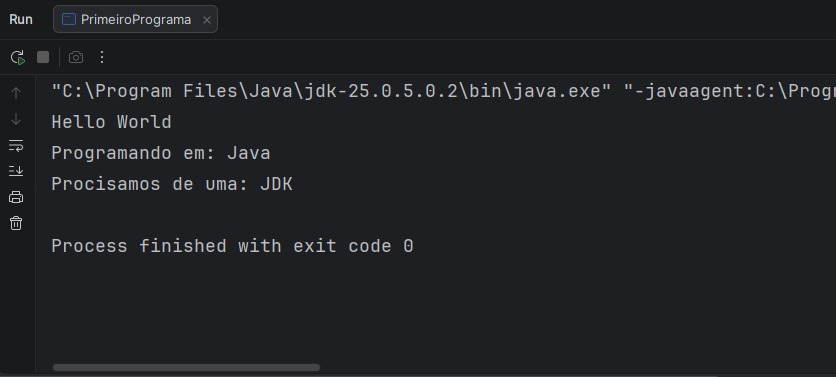
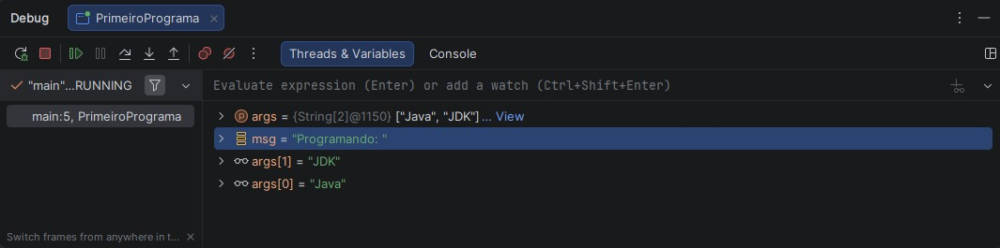

# Primeiro Programa Java

Exercício prático do **Módulo 2 — Introdução ao Java e seu Ambiente de Desenvolvimento**  
Bootcamp **Java & IA — Itaú + DIO**.

Este foi o primeiro programa Java um pouco mais completo, usado para praticar:

- compilação e execução do código;
- passagem de argumentos via `main`;
- uso de variáveis;
- debug no IntelliJ IDEA.

---

## 💻 Código utilizado

```java
public class PrimeiroPrograma {
    public static void main(String[] args) {
        String msg = "Programando em: ";

        System.out.println("Hello World");
        System.out.println(msg + args[0]);
        System.out.println("Precisamos de uma: " + args[1]);
    }
}
```

> ⚠️ Para esse código funcionar sem erro, é necessário passar **dois argumentos** na execução  
> (por exemplo: `Java` e `JDK`). Caso contrário, `args[0]` e `args[1]` vão gerar `ArrayIndexOutOfBoundsException`.

---

## ▶️ Execução com argumentos

Na configuração de execução do IntelliJ IDEA foi definido, em **Program arguments**:

```text
Java JDK
```

Assim:

- `args[0] = "Java"`
- `args[1] = "JDK"`

Saída no console:



---

## 🐞 Debug no IntelliJ IDEA

Durante o debug, foi possível inspecionar o conteúdo do array `args` e das variáveis locais.

### Visualizando variáveis em tempo de execução

Na aba **Threads & Variables**, o IntelliJ mostra o estado das variáveis enquanto o programa está em pausa no breakpoint:



Podemos ver:

- `args[0] = "Java"`
- `args[1] = "JDK"`
- `msg = "Programando em: "`

---

### Usando *Evaluate Expression*

Também foi utilizado o recurso **Evaluate Expression**, que permite avaliar expressões durante o debug, sem alterar o código fonte:

![Evaluate Expression com args[0]](./img/debug-evaluate-args0.png)

Nesse exemplo, foi avaliado o valor de `args[0]`, que retornou `"Java"`.

Esse recurso é útil para:

- testar expressões rapidamente;
- entender melhor o valor de variáveis em um determinado ponto do código;
- investigar problemas sem precisar adicionar vários `System.out.println`.

---

## 🧠 Aprendizados principais

- Como executar um programa Java passando argumentos via linha de comando.
- Como acessar esses argumentos através do array `String[] args`.
- Como configurar e utilizar breakpoints no IntelliJ IDEA.
- Como inspecionar variáveis e argumentos na aba **Threads & Variables**.
- Como usar o **Evaluate Expression** para investigar o valor de uma expressão durante o debug.

---

## 📂 Estrutura da atividade

```text
first-program-java/
├── PrimeiroPrograma.java   # código-fonte do exercício
├── README.md               # explicação e contexto
└── img/
    ├── debug-threads-variables.png
    ├── debug-evaluate-args0.png
    └── run-output.png
```

Essa organização facilita a visualização da evolução dos estudos, mantendo código, explicação e imagens de apoio no mesmo lugar.